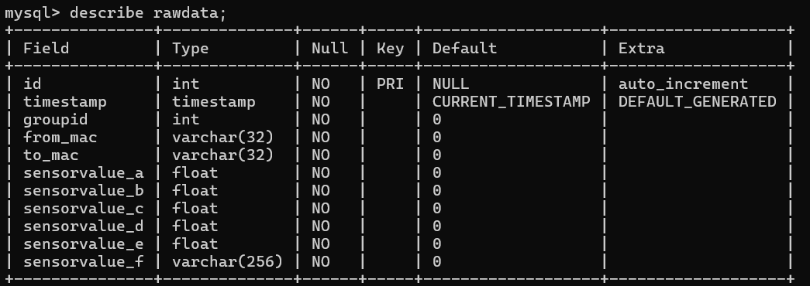
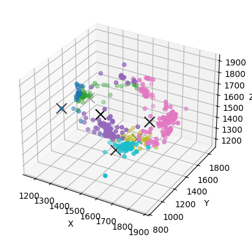
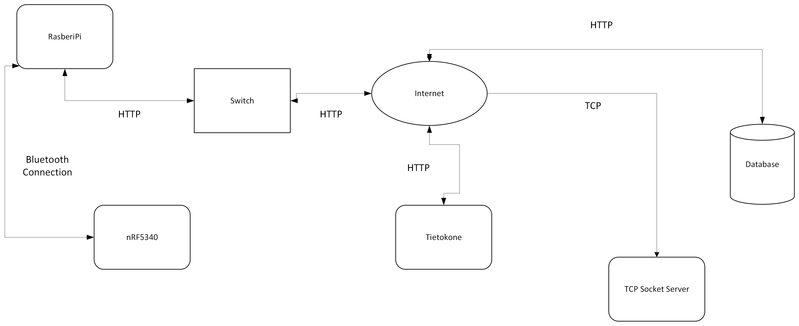

# Tietoliikenteen_sovellusprojekti

Tämä GitHub repositorio sisältää syksyllä 2026 tehtyyn tietoliikenteen sovellusprojektiin käytetyt koodit ja dokumentaation. Projektissa on suunniteltu Thingylle client, joka mittaa anturidataa ja välittää tietoa langattomasti IoT-reitittimelle. Reitittemenä käytetään Raspberry Pi:ta. Raspberry välittää dataa Oamkin MySQL-palvelimelle.

Tietokantaan tallentuvaan dataan on TCP-sokettirajapinta ja yksinkertainen HTTP API. Kerättyä dataa haetaan HTTP-rajanpinnasta koodatulla ohjelmalla ja käsitellään koneoppimistarkoituksiin.

# Bluetooth yhteys

Projektissa käytetään nrf5340 laitetta ja ADXL355 kiihtyvyysanturia mittausdatan hankkimiseen. Laitteelle koodit on tehty vs coden nrf connet lisäosalla. Data lähetetään bluetooth yhteydellä nrf laudalta Raspery pi:lle.

nrf5340:

ADXL355:

#Tietokanta

Raspery pi:sta mittausdata lähetetään ubuntu serverin tietokantaan, josta se voidaan hakea csv tiedostoon.
Tietokannan rakenne:

#K means algorytmi

K means algorytmin avulla mittaus datasta arvotaan 6 keskipistettä. Varmistetaan, että jokainen arvottu piste on lähin ainakin yhteen data pisteeseen. Arvotut pisteet (x) ja niiden lähimmät data pisteet voidaan visualisoida.

#Arkkitehtuurikuva
<!--
Source - https://stackoverflow.com/q/41604263
Posted by zjffdu, modified by community. See post 'Timeline' for change history
Retrieved 2026-10-29, License - CC BY-SA 4.0
-->

