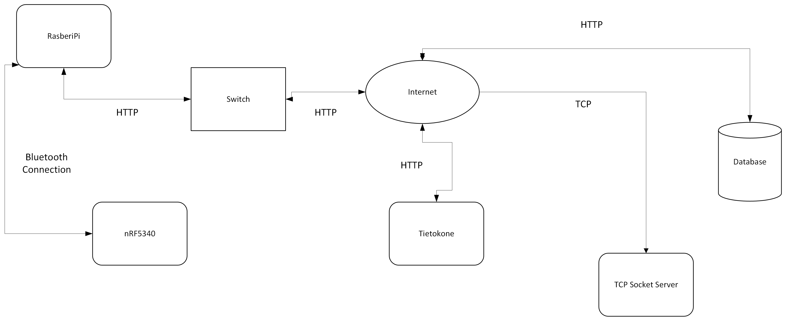

# Tietoliikenteen_sovellusprojekti

Tämä GitHub repositorio sisältää syksyllä 2026 tehtyyn tietoliikenteen sovellusprojektiin käytetyt koodit ja dokumentaation. Projektissa on suunniteltu Thingylle client, joka mittaa anturidataa ja välittää tietoa langattomasti IoT-reitittimelle. Reitittemenä käytetään Raspberry Pi:ta. Raspberry välittää dataa Oamkin MySQL-palvelimelle.

Tietokantaan tallentuvaan dataan on TCP-sokettirajapinta ja yksinkertainen HTTP API. Kerättyä dataa haetaan HTTP-rajanpinnasta koodatulla ohjelmalla ja käsitellään koneoppimistarkoituksiin.

# Arkkitehtuurikuva
<!--
Source - https://stackoverflow.com/q/41604263
Posted by zjffdu, modified by community. See post 'Timeline' for change history
Retrieved 2026-10-29, License - CC BY-SA 4.0
-->

